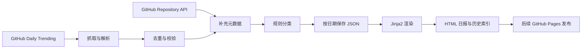

# GitHub Radar 设计初稿

状态：页面风格已确认，V1 真实日报已实现。AI 分析、定时任务和在线发布属于后续版本。

## 产品目标

让开发者每天快速发现值得进一步了解的开源项目。V1 先跑通真实数据到 HTML 日报的闭环，V2 再提供带来源依据的中文解读。

V1 默认：全领域 GitHub Daily Trending Top 20，阅读顺序优先展示 AI / Agent 项目，兼顾其他技术。只从抓取到的榜单中选择，不另外用 Search API 补足 AI 数量；分类后仍保留官方榜单的原始名次。如果榜单中没有 AI 项目，如实显示 0。

## 方案比较

| 方案 | 优点 | 成本与限制 | 建议 |
| --- | --- | --- | --- |
| Python + Jinja2 + 静态 HTML | 生成后可直接打开，容易存档与发布，运行成本低 | 个性化账户和跨设备收藏需要后续扩展 | 推荐作为 V1 |
| Python 数据任务 + Vue / React 前端 | 复杂筛选与多视图扩展更方便 | 多一个前端构建流程，当前需求暂时用不上 | 交互复杂后再考虑 |
| 全栈网站 + 数据库 + 后台任务 | 适合订阅、用户账户与多来源情报 | 服务维护、部署与权限设计更多 | 产品验证后再考虑 |

V1 建议使用 Python、httpx、BeautifulSoup、Jinja2 和少量原生 JavaScript。CSS 本地打包，不依赖线上 Tailwind CDN。JSON 作为报告数据格式，暂不引入数据库。

## 页面设计

视觉方向：白底、炭黑文字、绿色热度指标；蓝色和金色用于不同类别。紧凑的技术日报布局，强调项目名称、原始名次与可比较的数据。

页面结构：

1. 顶部品牌与日期选择，醒目标明原型中的演示数据。
2. 日报标题、实际采集时间、项目数、AI 项目数、技术分类数。
3. 搜索、分类、语言、排序以及 AI 优先 / 原始榜单切换。
4. 项目列表：原始名次、owner/repo、来源简介、分类、语言、总 Star、榜单当日新增 Star、GitHub 链接。
5. 侧栏展示整份日报的分类分布与来源；移动端移到列表后。
6. 没有匹配结果时显示空状态与清除筛选按钮。

统计值针对整份日报；筛选后的数量单独显示。改变日期时清除搜索与筛选、恢复默认排序，避免将上一篇的筛选误用于下一篇。日期控件只列出已成功生成的报告。

原型使用八个真实仓库名称帮助检验文字长度和信息层次。排名、日期、数值与简介为演示内容，不能作为真实榜单传播。原型中的两天数据只用于演示日期切换。

评审素材：[可交互页面](../../design/github-radar-prototype.html)、[桌面效果图](../../design/desktop-preview.jpg)、[手机效果图](../../design/mobile-preview.jpg)。

### 阅读排序与分类

- 原始榜单：按照 `trending_rank` 升序。
- AI 优先：按规则识别出的 AI / Agent 项目先显示，每组内部仍按原始名次。
- 今日增长 / 总 Star：按对应数字降序，缺失值置后，同值按原始名次排序。
- 分类：AI / Agent、开发工具、基础设施、应用与内容、其他。一个项目只计入一个主分类，AI 子标签可以是 Agent、LLM、RAG、MCP。
- 规则依据为仓库名称、简介和 API topics；关键词采用边界匹配，避免把包含 `ai` 字母的普通单词直接归为 AI。保留分类依据，允许配置规则。
- 缺失语言显示“未标注”，缺失 Star 显示“暂无数据”，不能用 0 代替缺失值。

### 中文内容边界

V1 提供中文界面和技术分类，保留仓库原始简介及其来源。没有中文源文本时直接显示原文，不声称自动生成中文摘要。自动翻译、技术亮点、场景与推荐理由属于 V2。

## 数据流程与模块



| 模块 | 责任 | 输出 |
| --- | --- | --- |
| trending | 获取 `since=daily` 页面并解析仓库顺序、当日新增 Star | 榜单条目与采集时间 |
| github | 通过仓库 REST API 补充描述、语言、topics、Star、URL | 仓库元数据 |
| classify | 使用可配置规则生成主分类与 AI 子标签 | 分类结果与命中依据 |
| report | 校验、按 owner/repo 去重、生成日报记录 | JSON 日报 |
| render | 安全转义文本，渲染日报与历史索引 | 静态 HTML |

Trending 页面提供榜单名次和榜单的当日增长数据。Repository API 提供当前仓库元数据。两者采集时间可能不同，不把总 Star 的差值解释成 Trending 的当日增长，也不把 Search API 结果称为官方 Trending。

页面解析的选择器与数据完整性必须通过真实抓取验证。V1 已在 2026-10-08 成功获取网页，并将 13 个项目的名称、原始名次和当日增长与同次保存的响应逐项核对。

建议数据字段：

| 层级 | 字段 |
| --- | --- |
| 报告 | schema_version、report_date、timezone、fetched_at、source_url、status、warnings、repos |
| 项目标识 | full_name、owner、name、html_url、trending_rank |
| 来源数据 | description_original、description_source、language、topics、stars_total、stars_today、metadata_fetched_at |
| 分类 | category、ai_tags、classification_reason |
| 后续 AI 扩展 | summary_zh、use_cases、highlights、recommendation、evidence、analysis_status、model、prompt_version |

可缺失数值使用 null。`stars_today` 是榜单提供的值，不是 API 计算值。所有报告日期使用 Asia/Shanghai，所有时间戳保存带时区的 ISO 8601 字符串。

## 文件与历史策略

建议正式实现结构：

```text
src/github_radar/      抓取、补充、分类、日报与渲染
templates/            日报和历史页面模板
assets/               本地 CSS 与交互脚本
config.toml           抓取数量、分类规则、展示模式
data/reports/         YYYY-MM-DD.json，持久保留
site/reports/         YYYY-MM-DD.html，生成产物
site/index.html       最新成功报告
site/archive.html     历史索引
tests/                解析 fixture、数据契约与渲染验证
.github/workflows/    后续定时生成和发布
```

同日重跑更新同日快照，不新增重复日期；只有全部验证与渲染成功才替换正式产物。不能仅上传当天的生成目录，否则部署后会丢失历史报告。自动化阶段应先保存日报 JSON 至专用数据分支，再基于全部历史重建站点，发布构建产物。

## 失败处理

- HTTP 超时与暂时性错误进行有限重试；遵守服务端的 Retry-After，避免无限循环。
- Trending 获取失败或解析出 0 个仓库：任务失败，不生成空的成功日报，不覆盖上一份成功结果。
- 合法返回不足 20 个仓库：显示实际数量并记录告警，不填充虚构项目。
- API 部分失败：保留榜单中已有信息，未知字段为 null，报告状态为 partial，并显示“部分数据缺失”。
- 不存在某日数据：历史索引不列出该日期；最新页面保留原报告日期与采集时间，不能改成今天来掩盖更新失败。
- 同日任务使用并发锁；渲染先写临时目录，再原子替换成功产物。
- 所有源文本安全转义，外链只允许 HTTPS GitHub 仓库地址；API Token 和 OpenAI Key 只保存在环境变量 / GitHub Secrets 中。

## 版本范围

| 阶段 | 交付 | 验收 |
| --- | --- | --- |
| V1 真实日报 | 手动运行抓取、补充与规则分类，生成 HTML 和 JSON；基础搜索、筛选 | 与同次采集源榜单核对；从文件直接打开可阅读、可筛选；无需 OpenAI Key |
| V1.1 自动化 | 定时与手动触发、历史存档、日期切换、Pages 发布 | 连续任务保留历史；失败不覆盖成功报告；发布后资产路径正确 |
| V2 AI 情报 | README 摘要、技术亮点、场景与证据链接 | 每个结论能追溯来源；失败退回原文；单次有调用预算 |
| V3 产品扩展 | 自定义方向、收藏 / 订阅、多来源 | 根据实际使用反馈单独定义 |

交互原型提前展示历史与日期控件，以评审完整网站结构；这些控件的正式数据来源将在 V1.1 实现。

自动化初稿安排在北京时间 08:17（UTC 00:17）触发，报告显示实际采集时间。GitHub Actions 定时任务可能延迟或丢弃，因此该时间是计划触发时间，不承诺准点完成。保留手动触发入口。

“为什么突然火”在 V2 中作为待证实的解释：先查 README、近期 release、提交与讨论。证据不足就明确写“原因暂未证实”，不能仅根据 Star 增长生成确定性原因。与其他框架的对比也必须有来源。

## 验证计划

- 解析 fixture：榜单顺序、数字分隔符、缺失语言 / 增长值、重复项目和网页结构变化。
- 数据契约：原始名次不因展示排序改变、缺失不变成 0、分类统计一致。
- 渲染：HTML 转义、合法外链、移动端无横向溢出、筛选与空状态、历史切换。
- 故障：Trending 失败不覆盖历史；API 部分失败仍能生成明确标记的报告；同日重跑幂等。
- 正式接入后执行一次真实抓取，对照同次响应，而不是对照之后可能变化的网页。

## 参考

- [GitHub Repository REST API](https://docs.github.com/en/rest/repos/repos#get-a-repository)：补充仓库元数据。
- [GitHub Actions schedule](https://docs.github.com/en/actions/reference/workflows-and-actions/events-that-trigger-workflows#schedule)：计划任务、默认分支与延迟说明。

## 本轮原型验证

2026-10-08 在浏览器中检查：默认八条项目、搜索命中单项目、搜索无结果、分类与语言组合无结果、清除筛选、两日切换后显示六条、原始名次 01 至 08、今日增长降序、总 Star 排序、AI 优先排序。检查了 320、390、714、1280 像素宽度，页面无横向溢出；桌面视图的八张仓库作者头像已成功加载。

内联脚本语法检查通过，无 console 调用或类型逃逸标记。本次只验证交互原型，不代表真实榜单获取、生成任务或在线部署已验证。

## V1 实现记录

实现位于 `src/github_radar/`，模板和前端资源随 Python 包保存在 `resources/` 中。命令入口为 `github-radar generate` 与 `github-radar rebuild`，使用方式见项目 README。

本次真实采集时间为 2026-10-08 15:49:47 CST，共 13 个项目，全部 API 补充成功。数量少于目标 20，页面明确提示，不补演示条目。规则识别出 10 个 AI / Agent 项目，共 3 类；分类结果只表示关键词命中，不是 AI 分析结论。

本地历史索引与按日期页面已一起实现，以保留重复运行产生的快照。定时执行、远程历史持久化及 Pages 发布仍属于 V1.1。

数据与站点目录之间不具备断电级事务保证。普通渲染或写入异常保留旧产物，异常中断后可用 `rebuild` 从有效 JSON 存档恢复站点。写入锁当前支持 macOS / Linux。
